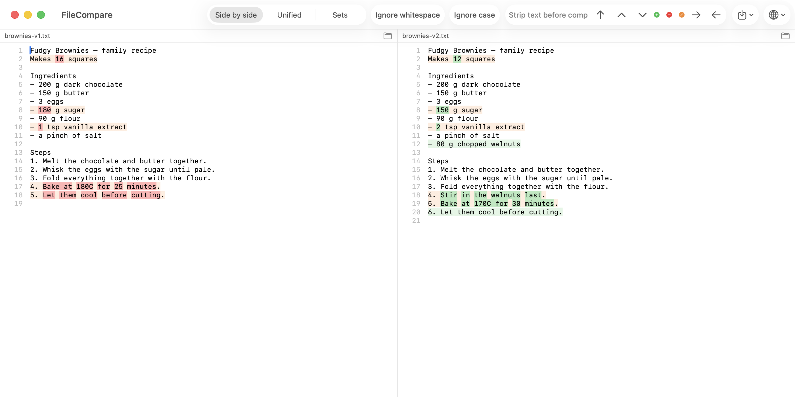
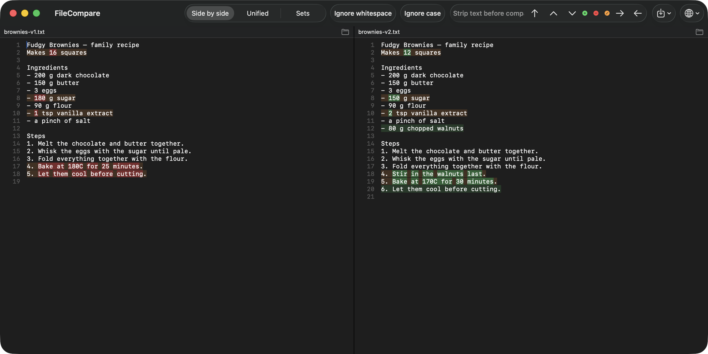

# FileCompare

[](https://github.com/malenitaa/FileCompare/releases/latest)
[](./LICENSE)
[](#)
[](./SECURITY.md)

**FileCompare** is a free, native **macOS** app to **compare two text or code
files side by side** (visual diff) — a simple take on the "compare" tools in
BBEdit or Notepad++. Written in **Swift/SwiftUI**: no Electron, no external
dependencies, 100% local. The interface is available in **English and
Spanish** (it follows your system language; the globe menu switches it) and
supports **light and dark mode**.

<p align="center">
  
</p>
<p align="center">
  
</p>

## Features

- Two editable side-by-side panels, or a unified `git diff`-style view.
- Line-level highlighting, plus word-level highlighting inside each line.
- Open files by drag & drop, folder button, or just paste text.
- Synced scrolling, line numbers, jump between changes (`⌘↓` / `⌘↑`).
- Toggles to ignore whitespace/case, and to strip text before comparing.
- **"Sets" mode**: compare two lists ignoring order (e.g. an Instagram
  "following"/"followers" export), showing "only in A", "in both", "only in B".
- Save each panel back to its file, undo/redo, remembers the last files opened.
- English/Spanish interface and light/dark mode, both following your system
  (with a manual override in the globe menu).

## Download and install

1. Go to [Releases](https://github.com/malenitaa/FileCompare/releases) and
   download `FileCompare-x.x.dmg`.
2. Open the `.dmg` and drag **FileCompare** into the **Applications** folder.
3. The first time you open it, macOS may warn that it **"cannot verify the
   developer"**. That's normal for any open-source app without a paid Apple
   signature — it doesn't mean anything is broken:
   - Right-click (or Ctrl+click) the app in Applications.
   - Choose **Open**.
   - Confirm in the dialog that appears.

   That's enough, one time only. **Never disable Gatekeeper** or any system
   protection — nothing here needs that, and if something asks you to, be
   suspicious.

Requires macOS 13 or later.

## Things that look like bugs but aren't

- **On big files, word-level highlighting turns off** (a banner tells you).
  Line-level diffing still works — this keeps the app responsive instead of
  freezing on huge files.
- **Files over 50MB show a warning** and may make the app slow. It still
  works; it's just honest about it.
- **Files over 100MB don't open** (a message says why). Past that size the
  app could run out of memory instead of just getting slow.

## Uninstall

Drag **FileCompare** from Applications to the Trash. The only other thing it
ever writes is one small preferences file (last opened files + language):
`~/Library/Preferences/io.github.malenitaa.FileCompare.plist` — delete that
too if you want zero trace left.

## Privacy

- **Zero network.** There is no networking code in the app — the whole diff
  is computed on your machine. You can verify this in the code.
- **Zero telemetry.** No accounts, no login, no tracking.
- It only reads and writes the files you explicitly open/save. The only thing
  it stores is the small preferences file described above.
- Full threat model, verifiable against the code: [SECURITY.md](./SECURITY.md).

## For developers

Requirements: macOS 13+, Xcode 15+.

```bash
git clone https://github.com/malenitaa/FileCompare.git
cd FileCompare
open FileCompare.xcodeproj
```

Build and run with `⌘R` from Xcode. The project file is generated with
[xcodegen](https://github.com/yonaskolb/XcodeGen) from `project.yml` (but the
generated `.xcodeproj` is committed, so plain clone-and-build works too).

## Enjoyed it?

If this was useful and you'd like to support the project:

- [Cafecito](https://cafecito.app/rezamalena)
- [Ko-fi](https://ko-fi.com/malenitaa)

## License

MIT — see [LICENSE](LICENSE).
